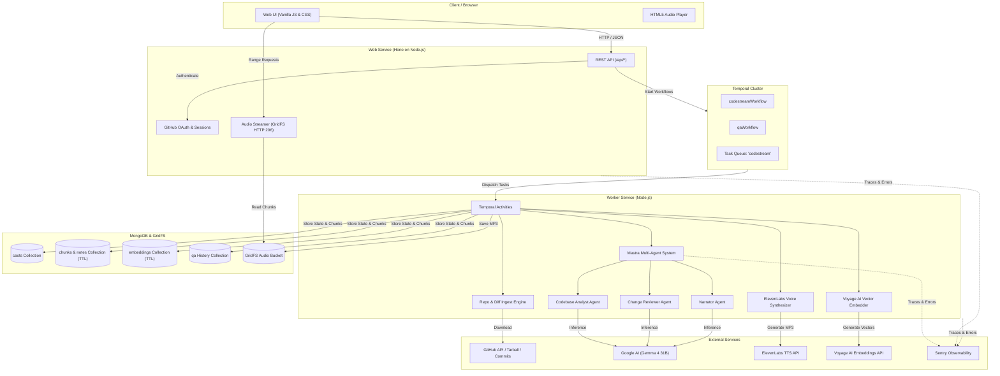

# CodeStream

> **Know what your coding agent actually built.**  
> Codebase tours, commit-change reviews, narrated audio briefings, and interactive Q&A.

[](https://nodejs.org/)
[](https://www.typescriptlang.org/)
[](https://temporal.io/)
[](https://mastra.ai/)
[](https://elevenlabs.io/)
[](https://ai.google.dev/)
[](https://vitest.dev/)

---

## Overview

AI coding agents (such as Claude Code, Cursor, GitHub Copilot, Codex, and Devin) can produce hundreds or thousands of lines of code in minutes. Reviewing these changes line-by-line is exhausting, while merging them blindly invites architectural drift, security vulnerabilities, stubbed logic, and regressions.

**CodeStream** solves this by acting as your automated tech lead and reviewer:
1. **Digests repositories and commit diffs** using intelligent file filtering, budget packing, and sensitive-file isolation.
2. **Analyzes code structure and risks** with specialized multi-agent AI pipelines powered by Google Gemma 4 on [Mastra](https://mastra.ai).
3. **Generates executive reports** detailing architecture, component maps, data flows, reading orders, and severity-ranked risk audits.
4. **Produces podcast-style audio briefings** ("casts") voiced by [ElevenLabs](https://elevenlabs.io), streamable with scrubbing support directly in your browser.
5. **Enables interactive grounded Q&A** backed by [Voyage AI](https://voyageai.com) vector embeddings, letting you interrogate any finished cast with cited answers.

---

## Architecture



---

## Key Features

### 🗺️ Codebase Tours (`kind: codebase`)
- Clones and extracts the repository at any branch, tag, or commit SHA.
- Dissects project structure, core entry points, data lifecycle, and system boundaries.
- Produces a clear **Tech Stack**, **Component Responsibility Breakdown**, and ordered **Reading List** for human reviewers.
- Categorizes concrete bugs, missing error handling, and code smells into severity levels (`high`, `medium`, `low`).

### 🔍 Commit-Change Reviews (`kind: changes`)
- Ingests git commit ranges (`base...ref` or latest $N$ commits on any branch).
- Inspects unified diffs, modified manifests, dependency shifts, and deleted tests.
- Delivers an executive overview, top change highlights, testing coverage analysis, and a commit-by-commit timeline.
- Generates an interactive **"Before You Trust It" Review Checklist** specifying exact files and behaviors to verify.

### 🎙️ Narrated Audio Briefings ("Casts")
- The Mastra `narrator` agent converts complex technical reports into a warm, natural spoken script designed for listening (avoiding raw code syntax or long file paths).
- Segment-aware synthesis via ElevenLabs TTS maintains natural vocal inflection across segment boundaries.
- Serves audio through HTTP 206 partial content streaming directly from MongoDB GridFS, supporting instant seeking and scrubbing.

### 💬 Grounded Q&A with File Citations
- Ask questions about any finished cast directly from the dashboard or API.
- Semantic vector retrieval using Voyage AI (`voyage-code-3`), ranking relevant code snippets against the query.
- Graceful degradation: falls back to chunk analysis notes if Voyage AI is not configured.
- Grounded prompt constraints force Gemma to cite exact file paths and functions and reject hallucinations.
- All exchanges are preserved in the cast's persistent Q&A history.

### 🛡️ Security & Zero-Leak Guardrails
- **Automated Secret Redaction**: Credential files (`.env`, `id_rsa`, `*.pem`, `*.key`, `service-account*.json`, `.npmrc`) are detected deterministically and never transmitted to the LLM. They are automatically flagged as security concerns in the report.
- **Noise Filtering**: Automatically ignores lockfiles (`package-lock.json`, `pnpm-lock.yaml`, `cargo.lock`), binary assets, images, vendor directories (`node_modules`, `vendor`, `.venv`), and build output (`dist`, `.next`).
- **Encrypted Credentials**: User GitHub OAuth tokens are encrypted with AES-256-GCM before database storage and decrypted only during worker ingestion.

### ⚙️ Resilient Distributed Workflows (Temporal)
- Ingestion, chunking, LLM inference, embedding generation, and voice recording execute as reliable Temporal activities.
- Automatic exponential backoff gracefully rides out LLM rate limits (`429`) and upstream API blips without failing the cast.
- Intermediate chunk notes and ingest snapshots are cached in MongoDB with automatic 7-day TTL cleanup.

---

## Tech Stack

| Layer | Technology | Purpose |
| :--- | :--- | :--- |
| **Runtime** | Node.js (>= 22) | Modern ES modules, native fetch, streams, and crypto |
| **Server Framework** | [Hono](https://hono.dev/) | High-performance, lightweight web server and REST API |
| **Workflow Engine** | [Temporal TypeScript SDK](https://temporal.io/) | Fault-tolerant distributed workflows and activity retries |
| **AI Framework** | [Mastra](https://mastra.ai/) | Multi-agent orchestration, structured outputs, prompt management |
| **Model** | Google Gemma 4 31B (`google/gemma-4-31b-it`) | Codebase analysis, diff review, synthesis, and scripting |
| **Voice Synthesis** | [ElevenLabs](https://elevenlabs.io/) | High-fidelity text-to-speech narration |
| **Vector Search** | [Voyage AI](https://voyageai.com/) (`voyage-code-3`) | Dense semantic code embeddings for grounded Q&A |
| **Database** | MongoDB & GridFS | Document persistence, vector indexes, and binary audio storage |
| **Validation** | [Zod](https://zod.dev/) | Strict schema validation for environment variables and API inputs |
| **Observability** | [Sentry](https://sentry.io/) | End-to-end tracing across HTTP, Temporal activities, and Mastra agent spans |
| **Testing** | [Vitest](https://vitest.dev/) | Fast unit and integration testing |

---

## Getting Started

### Prerequisites

- **Node.js**: `v22.0.0` or higher
- **MongoDB**: Local instance (`mongodb://127.0.0.1:27017`) or a free [MongoDB Atlas](https://www.mongodb.com/atlas) cluster
- **Temporal**: A local Temporal development server or a [Temporal Cloud](https://temporal.io/cloud) namespace
- **Google AI API Key**: Required for Gemma 4 (`GOOGLE_GENERATIVE_AI_API_KEY`)
- *(Optional)* **ElevenLabs API Key**: For voice narration
- *(Optional)* **Voyage AI API Key**: For code embeddings during Q&A
- *(Optional)* **GitHub Token or OAuth App**: For higher rate limits or accessing private repositories

---

### Installation

1. **Clone the repository:**
   ```bash
   git clone https://github.com/your-org/codecast.git
   cd codecast
   ```

2. **Install dependencies:**
   ```bash
   npm install
   ```

3. **Configure environment variables:**
   ```bash
   cp .env.example .env
   ```
   Edit `.env` and provide your credentials (at minimum `GOOGLE_GENERATIVE_AI_API_KEY`, `MONGODB_URI`, and Temporal connection details).

---

### Running Supporting Services

#### 1. MongoDB
Start a local MongoDB daemon or connect to MongoDB Atlas:
```bash
# Using Docker
docker run -d --name codestream-mongo -p 27017:27017 mongo:7
```

#### 2. Temporal Server
Run the local Temporal development server:
```bash
# Using the Temporal CLI
temporal server start-dev --ip 127.0.0.1 --port 7233
```
The Temporal Web UI will be available at `http://localhost:8233`.

---

### Running CodeStream

Run the API server and the background worker in separate terminal windows:

#### Terminal 1: Web & API Server
```bash
npm run dev
```
CodeStream will listen on `http://localhost:3000`.

#### Terminal 2: Temporal Worker
```bash
npm run dev:worker
```
The worker will begin polling the `codestream` task queue for jobs.

Open your browser at **`http://localhost:3000`** to start creating casts!

---

## Environment Variables

All settings are configured via environment variables or a `.env` file:

| Variable | Type | Default | Description |
| :--- | :--- | :--- | :--- |
| `NODE_ENV` | String | `development` | Runtime environment (`development` or `production`) |
| `PORT` | Number | `3000` | Port for the Hono web server |
| `MONGODB_URI` | String | `mongodb://127.0.0.1:27017` | MongoDB connection URI |
| `MONGODB_DB` | String | `codestream` | Database name |
| `TEMPORAL_TASK_QUEUE` | String | `codestream` | Task queue name polled by the worker |
| `TEMPORAL_ADDRESS` | String | *Unset (local: 127.0.0.1:7233)* | Address of Temporal server or Temporal Cloud |
| `TEMPORAL_NAMESPACE` | String | `default` | Temporal namespace |
| `TEMPORAL_API_KEY` | String | *Optional* | API key for Temporal Cloud |
| `CODESTREAM_API_TOKEN` | String | *Optional* | Shared bearer token for securing HTTP API endpoints |
| `GITHUB_CLIENT_ID` | String | *Optional* | GitHub OAuth App Client ID (enables GitHub Sign-in) |
| `GITHUB_CLIENT_SECRET` | String | *Optional* | GitHub OAuth App Client Secret |
| `GITHUB_CALLBACK_URL` | String | `http://localhost:3000/auth/github/callback` | OAuth redirect callback URL |
| `SESSION_SECRET` | String | *Optional (min 32 chars)* | Secret used to seal session cookies and encrypt tokens |
| `GITHUB_TOKEN` | String | *Optional* | Global GitHub personal access token for higher rate limits |
| `CODESTREAM_MODEL` | String | `google/gemma-4-31b-it` | Mastra model identifier |
| `GOOGLE_GENERATIVE_AI_API_KEY` | String | *Required for Gemma* | Google AI API Key |
| `LLM_CHUNK_CHARS` | Number | `24000` | Character size per source/diff chunk sent to LLM |
| `LLM_CONCURRENCY` | Number | `2` | Parallel chunk summarization limit (to avoid rate limits) |
| `CODEBASE_MAX_CHARS` | Number | `600000` | Maximum characters of repository source code ingested |
| `CHANGES_MAX_CHARS` | Number | `400000` | Maximum characters of commit diffs ingested |
| `ELEVENLABS_API_KEY` | String | *Optional* | ElevenLabs API key for voice narration |
| `ELEVENLABS_VOICE_ID` | String | `JBFqnCBsd6RMkjVDRZzb` | Voice ID for narration |
| `ELEVENLABS_MODEL_ID` | String | `eleven_multilingual_v2` | ElevenLabs TTS model |
| `VOYAGE_API_KEY` | String | *Optional* | Voyage AI API key for semantic code embeddings |
| `VOYAGE_EMBEDDING_MODEL` | String | `voyage-code-3` | Embedding model name |
| `VOYAGE_EMBEDDING_DIMENSIONS`| Number | `1024` | Embedding vector dimensions (`256`, `512`, `1024`, `2048`) |
| `SENTRY_ENABLED` | Boolean | `false` | Enable Sentry application monitoring (`true`/`false`) |
| `SENTRY_DSN` | String | *Optional* | Sentry project DSN |

---

## API Reference

When `CODESTREAM_API_TOKEN` is set, all `/api/*` endpoints require an `Authorization: Bearer <token>` header (or a `?token=<token>` query parameter for media streaming). When GitHub OAuth is enabled, authentication is handled via secure session cookies.

### 1. Create a Cast
**`POST /api/casts`**

Starts an asynchronous Temporal workflow to analyze a repository or commit range.

**Request Body:**
```json
{
  "repoUrl": "facebook/react",
  "kind": "codebase",
  "ref": "main",
  "audio": true
}
```
*For commit-change reviews:*
```json
{
  "repoUrl": "facebook/react",
  "kind": "changes",
  "base": "v18.0.0",
  "ref": "v18.1.0",
  "commitLimit": 15,
  "audio": true
}
```

**Response (`202 Accepted`):**
```json
{
  "cast": {
    "id": "aB1cD2eF3g",
    "kind": "codebase",
    "repo": {
      "owner": "facebook",
      "name": "react",
      "fullName": "facebook/react",
      "url": "https://github.com/facebook/react"
    },
    "status": "queued",
    "stage": "Queued",
    "createdAt": "2026-10-18T18:00:00.000Z"
  }
}
```

---

### 2. List Recent Casts
**`GET /api/casts?limit=30`**

Returns summaries of recently created casts.

**Response (`200 OK`):**
```json
{
  "casts": [
    {
      "id": "aB1cD2eF3g",
      "kind": "codebase",
      "repo": { "owner": "facebook", "name": "react", "fullName": "facebook/react" },
      "status": "ready",
      "stage": "Ready",
      "title": "React: The library for web and native user interfaces",
      "createdAt": "2026-10-18T18:00:00.000Z",
      "completedAt": "2026-10-18T18:02:15.000Z"
    }
  ]
}
```

---

### 3. Get Cast Details
**`GET /api/casts/:id`**

Fetches status, progress, generated reports, risk findings, and narration script.

**Response (`200 OK`):**
```json
{
  "cast": {
    "id": "aB1cD2eF3g",
    "kind": "codebase",
    "status": "ready",
    "stage": "Ready",
    "hasAudio": true,
    "report": {
      "title": "React Architecture Overview",
      "tldr": "A declarative, component-based UI library...",
      "purpose": "Enables developers to construct reactive user interfaces.",
      "architecture": "Organized into core reconciler, renderer packages...",
      "techStack": ["TypeScript", "Flow", "JavaScript"],
      "components": [
        {
          "name": "Reconciler",
          "responsibility": "Manages fiber tree diffing and scheduling",
          "paths": ["packages/react-reconciler"]
        }
      ],
      "risks": [
        {
          "severity": "medium",
          "title": "Uncaught reconciler error boundary propagation",
          "detail": "Async lane transitions can skip top-level recovery boundaries.",
          "paths": ["packages/react-reconciler/src/ReactFiberWorkLoop.js"]
        }
      ]
    },
    "script": "Welcome to CodeStream. Today we are breaking down React..."
  }
}
```

---

### 4. Stream Audio Briefing
**`GET /api/casts/:id/audio`**

Streams the synthesized MP3 audio from MongoDB GridFS. Supports HTTP 206 Byte-Range requests for scrubbed audio seeking.

---

### 5. Ask a Grounded Question
**`POST /api/casts/:id/qa`**

Ask a question against a completed cast. Answers are grounded in the repository passages with exact file citations.

**Request Body:**
```json
{
  "question": "Where does the request state get stored?"
}
```

**Response (`201 Created`):**
```json
{
  "qa": {
    "id": "xyz789",
    "question": "Where does the request state get stored?",
    "answer": "Request state is managed by the session middleware in src/auth/session.ts and stored in sealed HTTP cookies.",
    "citations": [
      "src/auth/session.ts",
      "src/server/app.ts"
    ],
    "createdAt": "2026-10-18T18:05:00.000Z"
  }
}
```

---

### 6. List Q&A History
**`GET /api/casts/:id/qa`**

Retrieves all previous question-and-answer exchanges for the cast.

---

### 7. Health Check
**`GET /healthz`**

Returns `{ "ok": true }` to verify HTTP service availability.

---

## Development & Testing

### Running Tests
Execute the Vitest test suite:
```bash
npm test
```
The suite runs 18 unit and integration tests covering:
- **Audio processing**: Text segmentation and boundary context handling
- **Authentication**: Session signing, state verification, AES encryption
- **Ingestion**: File classification, priority sorting, sensitive file discovery, tarball unpacking
- **HTTP Server**: Input validation, routing, error mapping, and security headers

### Typechecking & Verification
Verify full TypeScript type safety across both web server and worker configs:
```bash
npm run typecheck
```

### Production Build
Compile TypeScript to the `dist/` output directory:
```bash
npm run build
```

Run production binaries with Sentry instrumentation enabled:
```bash
# Start Web Server
npm run start:web

# Start Background Worker
npm run start:worker
```

---

## Deployment (Render)

CodeStream includes a production-ready Render Blueprint in [`render.yaml`](./render.yaml).

### Deploying to Render
1. Push your repository to GitHub.
2. In the [Render Dashboard](https://dashboard.render.com/), choose **New +** → **Blueprint**.
3. Select your repository. Render will automatically configure two services:
   - **`codestream-web`**: Web service serving Hono and the frontend dashboard with health check at `/healthz`.
   - **`codestream-worker`**: Background worker running Temporal worker activities.
4. Set the secret environment variables in the Render dashboard:
   - `MONGODB_URI`
   - `TEMPORAL_ADDRESS`, `TEMPORAL_NAMESPACE`, `TEMPORAL_API_KEY`
   - `GOOGLE_GENERATIVE_AI_API_KEY`
   - `ELEVENLABS_API_KEY`
   - `SESSION_SECRET`
   - `GITHUB_CLIENT_ID` and `GITHUB_CLIENT_SECRET` (if using OAuth)
5. Click **Apply** to deploy!

---

## Project Structure

```text
codecast/
├── public/                 # Static web dashboard (HTML, CSS, modern JS)
│   ├── app.js              # Single-page application logic and API client
│   ├── index.html          # Main application markup
│   └── styles.css          # Design system and layout
├── src/
│   ├── audio/              # ElevenLabs text-to-speech & audio segmentation
│   ├── auth/               # GitHub session sealing & token encryption
│   ├── db/                 # MongoDB store, GridFS audio, TTL scratch indexes
│   ├── embeddings/         # Voyage AI embedding generation and vector similarity
│   ├── github/             # GitHub API client, OAuth flow, tarball extraction
│   ├── ingest/             # Codebase snapshotting, diff extraction, filtering
│   ├── mastra/             # Mastra agents, Gemma prompts, and Zod output schemas
│   ├── qa/                 # Semantic search & grounded question-answering service
│   ├── server/             # Hono web server, API routes, and static serving
│   ├── temporal/           # Workflows, activities, worker, and Sentry interceptors
│   ├── config.ts           # Environment schema validation (Zod)
│   ├── domain.ts           # Domain models and TypeScript interfaces
│   └── instrument.ts       # Sentry performance and error instrumentation
├── test/                   # Vitest unit and integration test suites
├── render.yaml             # Render infrastructure-as-code deployment blueprint
├── package.json            # Node.js dependencies and script definitions
├── tsconfig.json           # Base TypeScript compiler configuration
└── tsconfig.worker.json    # Temporal worker compilation configuration
```

---

## License

Private / Proprietary. All rights reserved.
